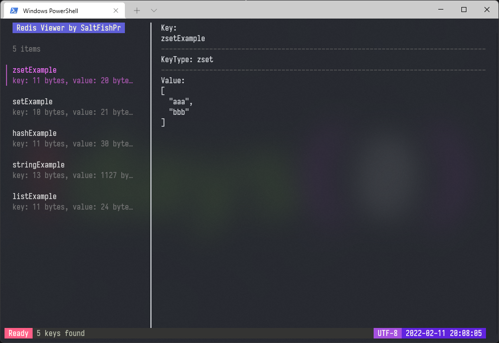

# Redis Viewer

`redis-viewer` is a terminal UI for browsing Redis keys and inspecting values.



Built with [Bubble Tea](https://github.com/charmbracelet/bubbletea).

## Features

- Browse Redis keys in a terminal UI
- Inspect `string`, `hash`, `list`, `set`, and `zset` values
- Search keys with Redis `SCAN` match patterns
- Paginate through matched keys

## Install

### Go install

Requires Go `1.25` or newer:

```bash
go install github.com/saltfishpr/redis-viewer@latest
```

### Download binary

Download a release from [GitHub Releases](https://github.com/saltfishpr/redis-viewer/releases).

## Usage

Show help:

```bash
redis-viewer --help
```

Run with the default config file:

```bash
redis-viewer
```

Run with a specific config file:

```bash
redis-viewer --config ./redis-viewer.yaml
```

## Configuration

Default config path:

```text
$HOME/.redis-viewer.yaml
```

Example:

```yaml
addrs:
  - 127.0.0.1:6379

db: 0
username: ""
password: ""

# Used for sentinel mode.
master_name: ""

# Number of keys shown per page.
page_size: 20
```

### Notes on connection modes

- Single node: set one address in `addrs`
- Cluster: set multiple cluster node addresses in `addrs`
- Sentinel: set sentinel addresses in `addrs` and set `master_name`

## Keybindings

| Key       | Action               |
| --------- | -------------------- |
| `Ctrl+C`  | Quit                 |
| `↑` / `↓` | Move selection       |
| `←`       | Previous page        |
| `→`       | Next page            |
| `r`       | Reload current page  |
| `s`       | Enter search mode    |
| `Enter`   | Apply current search |
| `Esc`     | Cancel search mode   |

## Known Limitations

- Only `string`, `hash`, `list`, `set`, and `zset` are rendered
- Unsupported key types are shown as errors in the item detail
- Windows system requires terminal encoding to be set to `UTF-8`

## License

[MIT](LICENSE)
